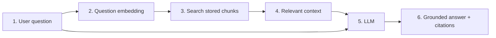

# Module 1 — Complete RAG flow

## Why RAG exists

An LLM knows what it learned during training. It does not automatically know your private documents or recent changes.

RAG fetches relevant information at question time and includes it with the prompt.



## Five important terms

- **Document:** Original source, such as a Markdown file or PDF.
- **Chunk:** A smaller meaningful part of a document.
- **Embedding:** Numbers representing the meaning of text.
- **Vector search:** Finding chunks whose meaning is close to the question.
- **Generation:** The LLM writes an answer using retrieved chunks.

## Real example

Question: “How does Action Items Library handle duplicate names?”

```text
Retrieve the relevant service documentation
-> provide the uniqueness-rule chunks to the LLM
-> answer that names are checked case-insensitively
-> cite the source file
```

## RAG is not suitable for everything

| Question | Correct system |
|---|---|
| How does this feature work? | RAG over documentation |
| Show current HIGH-priority templates | MongoDB/MCP tool |
| Explain these current records | MCP data + RAG documentation |

Do not copy frequently changing transactional MongoDB data into a vector store just to query exact values.

## Local versus production

```text
Local:      files -> manual ingestion -> local pgvector -> API
Production: sources -> workers/queue -> managed pgvector -> scalable API
```

The logical RAG flow stays the same. Production adds automation, permissions, reliability, and monitoring.

## Common mistakes

- Sending every document to the LLM instead of retrieving a small context.
- Expecting vector search to perform exact database filtering.
- Assuming RAG completely prevents hallucination.
- Adding frameworks before understanding the request flow.

## Revision

```text
RAG = retrieve useful chunks + generate an answer from those chunks.
```
