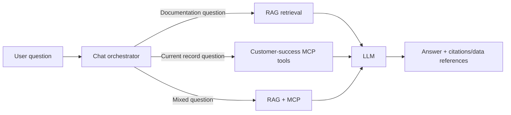

# Module 10 — Customer-success RAG architecture

The assistant should route questions to the system that owns the truth.



## Ownership

| Information | Source of truth |
|---|---|
| Feature behavior and documentation | RAG document index |
| Current Action Items Library records | MongoDB through MCP tools |
| Current tenant/customer state | Existing services through MCP tools |
| Conversation wording | LLM |

## Example flows

### Documentation only

```text
Question: How does duplicate-name validation work?
RAG: retrieve service/module documentation
Answer: explain the rule and cite the source
```

### Current data only

```text
Question: Show current HIGH-priority templates.
MCP: call search_action_item_templates(priority="HIGH")
Answer: format the current MongoDB results
```

### Combined

```text
Question: Which current HIGH-priority templates may conflict by name,
and what is the product rule?

MCP -> fetch current HIGH-priority templates
RAG -> fetch uniqueness-rule documentation
LLM -> explain using both, without changing data
```

## Suggested production architecture

```text
Chat UI
  -> Chat/orchestration API
       -> LLM
       -> Customer-success MCP server -> existing services -> MongoDB
       -> RAG retrieval service -> PostgreSQL/pgvector

Document sources -> queue -> ingestion workers -> S3 + pgvector
```

Keep the MCP and RAG responsibilities separate even if they live in one repository initially.

## Tenant safety

The chat backend authenticates the user once. It passes trusted identity/tenant context to both retrieval and MCP. The LLM must never choose the MongoDB database or bypass RAG metadata filters.

## Development order

1. RAG over approved Action Items Library documentation.
2. Evaluate documentation questions.
3. Connect existing read-only MCP tools for current records.
4. Add routing rules for RAG, MCP, or both.
5. Test cross-tenant and prompt-injection cases.
6. Add other customer-success feature documentation gradually.

## Do we need an agent framework?

Not initially. A small orchestrator can provide the LLM with approved tools and a RAG search operation. Add a framework only when it removes proven complexity.

## Final architecture rule

```text
RAG retrieves knowledge.
MCP performs controlled access to live systems.
The LLM combines results but does not own permissions or business rules.
```
