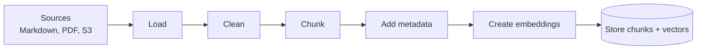

# Module 2 — Data ingestion architecture

Ingestion prepares documents before users can search them. It is an offline/background flow, not part of every chat request.



## One chunk should store

```text
chunk_id
document_id
chunk_text
embedding
tenant_id
source_path / source_url
title and section
document_version
permission fields
created_at / updated_at
```

Metadata is as important as the embedding. It lets retrieval filter by tenant, permissions, feature, language, or document type.

## Chunking

Prefer splitting by document structure:

```text
heading -> paragraph -> list -> code block
```

Use size-based splitting only when structure is unavailable. Small chunks lose context; huge chunks waste tokens and mix unrelated ideas. Start with a reasonable size, then evaluate—there is no universal perfect number.

## Updates and deletion

Give every source a stable `document_id` and content checksum.

```text
New checksum     -> create new chunks and embeddings
Same checksum    -> skip work
Deleted document -> delete or deactivate all its chunks
```

Write new-version chunks first, validate them, then switch the active version. This prevents users from seeing half-indexed documents.

## Local development

- Read a small `documents/` folder.
- Run ingestion manually.
- Save original documents locally.
- Store chunks in local PostgreSQL + pgvector.
- Inspect chunk text and metadata directly.

## Production

```text
S3/source event -> queue -> ingestion worker -> vector store
                         -> retry/DLQ on failure
```

Store raw files in S3, not inside queue messages. Send only a document ID and location through the queue.

## Common mistakes

- Re-embedding every file on every run.
- Losing headings and source locations.
- Missing tenant and permission metadata.
- Updating chunks in place and exposing partial versions.
- Running PDF parsing and embedding inside a user request.

## Revision

```text
Ingestion makes trusted, versioned, permission-aware chunks searchable.
```
