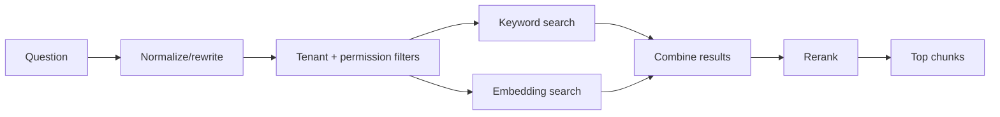

# Module 3 — Retrieval architecture

Retrieval decides which information reaches the LLM. If retrieval is wrong, a better LLM usually cannot fix the answer.



## Search types

| Type | Good at |
|---|---|
| Keyword search | Exact IDs, class names, error messages and product terms |
| Vector search | Similar meaning expressed with different words |
| Hybrid search | Combining both strengths |

Customer-success documentation contains exact names such as `action_library_id`, so hybrid search is often better than vector-only search.

## Safe retrieval order

1. Read authenticated `tenant_id` and user permissions.
2. Build metadata filters.
3. Search only allowed chunks.
4. Combine keyword and vector candidates.
5. Rerank the small candidate set.
6. Return the best chunks with source metadata.

Permission filtering must happen before context is sent to the LLM.

## Top-K and reranking

`top_k` means how many chunks are retrieved. Too few may miss the answer; too many add noise and token cost.

Start with a small number such as 5–10, evaluate it, and tune from evidence. A reranker can score perhaps 20–50 candidates and keep the best few.

## Local development

For each test question, print:

```text
retrieved chunk text
source
similarity/ranking score
metadata filters
```

Debug retrieval before debugging the final prompt.

## Production and scale

- Index `tenant_id`, permissions, and other filter columns.
- Add a vector index only after measuring exact-search latency.
- Use `EXPLAIN ANALYZE` for pgvector queries.
- Cache query embeddings when safe.
- Move to a dedicated vector system only when pgvector cannot meet measured scale or latency.

pgvector supports exact search and approximate HNSW/IVFFlat indexes. Approximate search is faster at scale but can miss relevant rows, especially with filtering, so evaluate recall.

## Common mistakes

- Treating similarity score as proof that a chunk answers the question.
- Filtering tenant data after retrieval.
- Sending duplicate chunks from the same document.
- Tuning only latency while ignoring retrieval quality.

## Revision

```text
Retrieve broadly enough to find the answer, then filter and rerank to remove noise.
```

Reference: [Official pgvector documentation](https://github.com/pgvector/pgvector)
