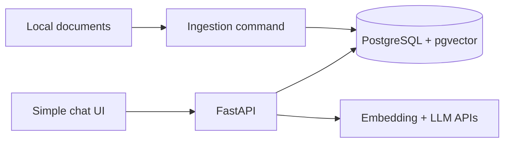

# Module 5 — Local development

Build the smallest system in which every step can be inspected.



## Suggested local components

```text
FastAPI                RAG API
PostgreSQL + pgvector  chunks, vectors and metadata
Docker Compose         local database
documents/             approved sample sources
one ingestion command  manual and repeatable
simple UI              optional at the beginning
```

Do not add Redis or background workers on day one. First make manual ingestion and one question work correctly.

## Suggested project structure

```text
rag-app/
├── app/
│   ├── api/            # ask endpoint
│   ├── ingestion/      # load, clean, chunk, embed
│   ├── retrieval/      # search and rerank
│   ├── generation/     # prompt and LLM call
│   └── db/             # tables and queries
├── documents/
├── evaluations/
├── tests/
├── docker-compose.yml
└── .env.example
```

## Development order

1. Ingest one clean Markdown file.
2. Inspect chunks manually.
3. Search with a question and inspect results.
4. Add the LLM only after retrieval works.
5. Return answer and citations from FastAPI.
6. Add a basic UI.
7. Add more document formats later.

## Separate endpoints/commands

```text
CLI:  ingest document
API:  ask question
API:  inspect retrieval (development only)
```

Do not expose the debugging endpoint in production because it may reveal raw private chunks.

## Configuration

Keep model name, embedding model, database URL, chunk settings, and API keys in settings/environment variables. Commit `.env.example`, never `.env`.

## Common mistakes

- Building the UI before testing retrieval.
- Testing with hundreds of documents immediately.
- Hiding every step behind a large framework.
- Changing chunking, embeddings, and prompts simultaneously.

## Revision

```text
Local development must make chunks, retrieved context, prompt, answer, and citations inspectable.
```
