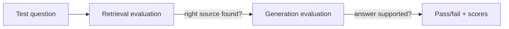

# Module 6 — Evaluation and testing

RAG quality cannot be judged from one impressive demo.

## Build a small evaluation set

Start with 20–50 real questions:

```text
question
expected answer or key facts
expected source document/section
tenant and permission context
whether the system should refuse
```

Include easy, difficult, ambiguous, out-of-scope, and access-denied questions.

## Evaluate two stages separately



### Retrieval checks

- Did the correct chunk appear in the top results?
- Were unauthorized chunks excluded?
- Were results relevant rather than merely similar?

Useful measures include Hit Rate/Recall at K and ranking position. For a beginner, “expected source appeared in top 5” is enough.

### Answer checks

- Correctness: does it answer the question?
- Faithfulness: is every factual claim supported by context?
- Citation correctness: do cited sources support the statement?
- Completeness: are important expected facts present?
- Refusal: does it admit when information is missing?

## Testing levels

```text
Unit tests        cleaning, chunking, filters
Integration tests embedding/vector store/LLM boundaries
Evaluation tests real question set
Security tests    cross-tenant and prompt-injection cases
Human review      usefulness and clarity
```

## Regression process

Run the same evaluation set before and after changing:

- embedding model;
- chunking;
- search parameters;
- reranker;
- prompt;
- LLM.

Change one major variable at a time and record the version.

## Production feedback

Allow users to mark answers helpful/unhelpful and report incorrect citations. Never treat thumbs-up alone as proof of factual correctness.

## Common mistakes

- Evaluating only final wording.
- Using only questions written by developers.
- Letting an LLM judge everything without human checks.
- Deploying model or prompt changes without regression tests.

## Revision

```text
First ask whether retrieval found the evidence; then ask whether generation used it correctly.
```
