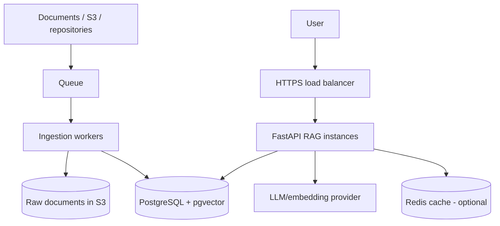

# Module 7 — Production architecture

Production separates background ingestion from online question answering.



## Component responsibilities

| Component | Job |
|---|---|
| FastAPI | Authentication, retrieval, prompt, response |
| Worker | Parse, chunk, embed and index documents |
| Queue | Absorb work and support retries |
| S3 | Durable original files |
| PostgreSQL + pgvector | Chunks, metadata and vector search |
| Redis | Optional cache; not source of truth |
| LLM provider | Embeddings and answer generation |

## Environments

```text
Development -> sample/non-sensitive documents
Staging     -> production-like deployment and evaluation
Production  -> real users and approved data
```

Use separate databases, storage buckets, credentials, and vector indexes. Do not distinguish environments using only a metadata field in one shared table.

## Deployment

The FastAPI RAG service deploys like a normal containerized API:

```text
Docker -> EC2/ECS -> ALB -> HTTPS
```

Workers use the same image with a different startup command. Scale API instances for question traffic and workers for ingestion backlog.

## One production request

1. Authenticate the user.
2. Resolve tenant and permissions.
3. Embed/rewrite the question.
4. Retrieve authorized chunks.
5. Call the LLM with context.
6. Return answer, citations, and request ID.
7. Emit logs, metrics, and trace timings.

## Common mistakes

- Running ingestion inside FastAPI requests.
- Giving API and workers the same excessive permissions.
- Sharing development and production vector data.
- Deploying without evaluation gates or rollback versions.

## Revision

```text
Online path answers users quickly; offline workers keep knowledge current.
```
