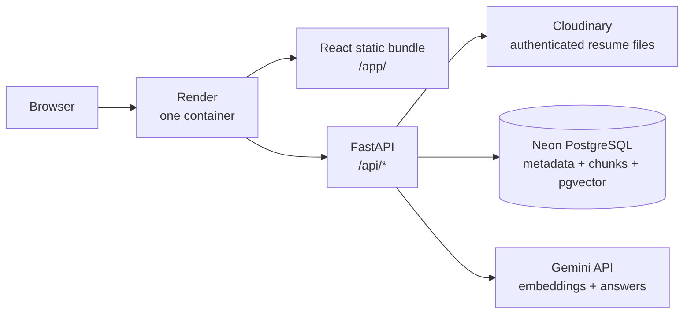
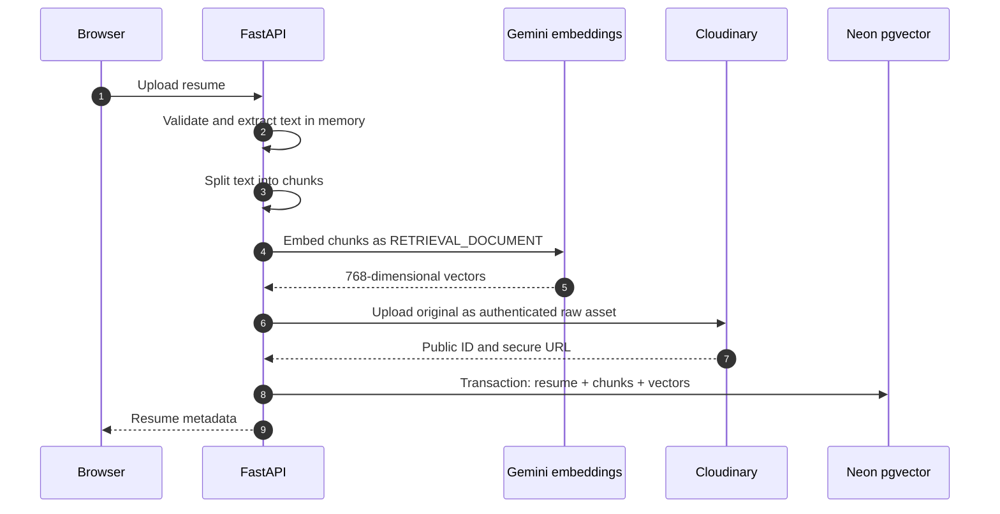
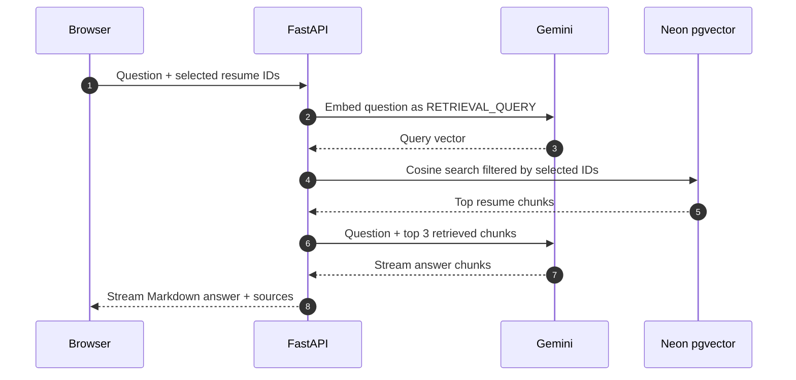

# Architecture

## Deployed architecture



Vite compiles React while the Docker image is built. FastAPI serves that static bundle, so the frontend and API use one Render service and one domain. `/` redirects to `/app/`; backend routes use `/api/*`.

FastAPI has no persistent local state, so Render can restart or replace the container without losing resumes or vectors.

## Upload flow



If the database transaction fails after upload, the application removes the Cloudinary asset.

## Question flow



The Gemini HTTP client is created once at FastAPI startup and reuses its connections. Streaming reduces perceived latency because React renders the first answer text before Gemini finishes the complete response.

## What is stored where?

### Cloudinary

- Original PDF, DOCX, or TXT file
- Uploaded as `raw` with authenticated delivery
- Cloudinary public ID stored in PostgreSQL for deletion

### Neon PostgreSQL

```text
resumes
  id, original_name, Cloudinary IDs, upload time, model, chunk count

resume_chunks
  resume_id, chunk number, text, vector(768)
```

The `vector` extension performs cosine similarity search. PostgreSQL foreign-key cascade deletes chunks when a resume is deleted.

### Gemini

- `gemini-embedding-001` creates 768-dimensional document/query vectors.
- `gemini-3.1-flash-lite` generates answers from retrieved context with low latency.
- No model output is used as database authorization.

## Why not hosted Ollama?

Ollama Cloud has a free plan with starter credits, but it is quota-based and hosted model availability can differ. Gemini currently provides an official free tier for both generation and embeddings, making this deployment simpler.

The `ai_client.py` boundary means Gemini can later be replaced with Ollama Cloud or another provider without changing parsing, storage, routes, or retrieval.

## Scaling later

For this project, exact pgvector search is enough. Later:

```text
Add an HNSW index after measuring query latency
Move upload processing to a worker queue
Add authentication and per-user resume ownership
Use paid instances to remove sleep and quota limitations
```
