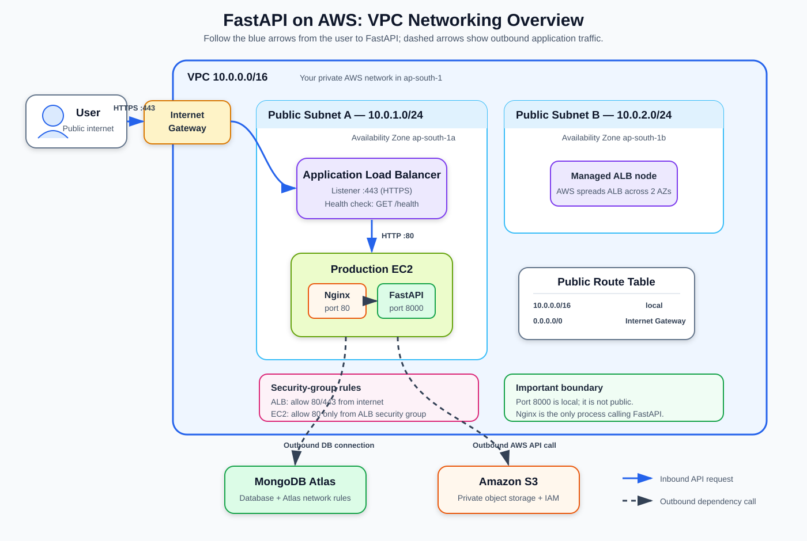
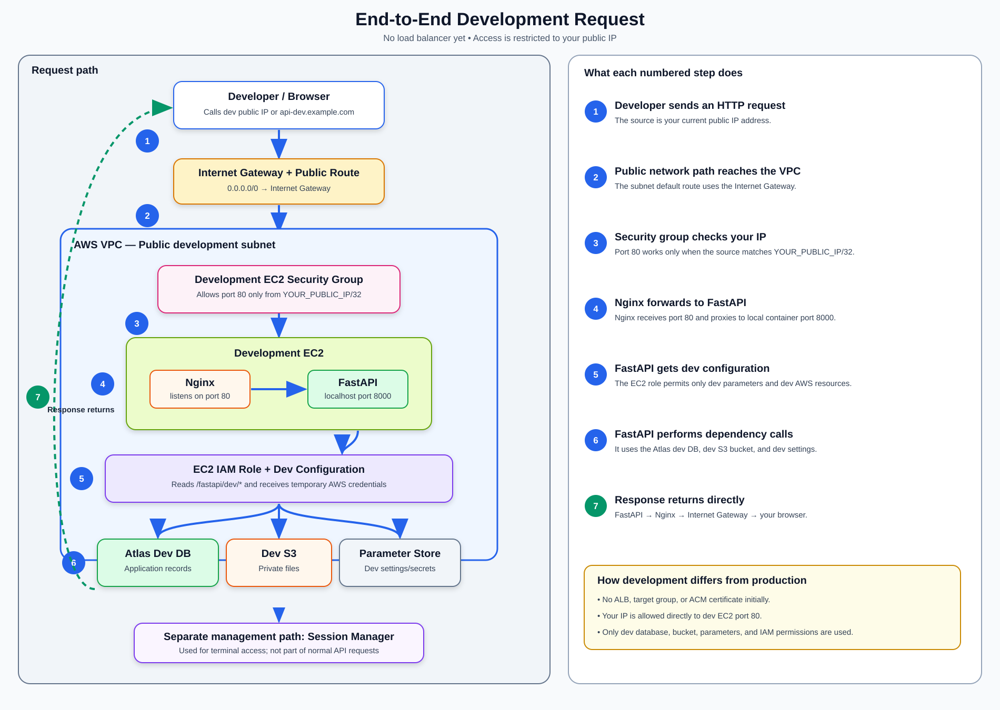
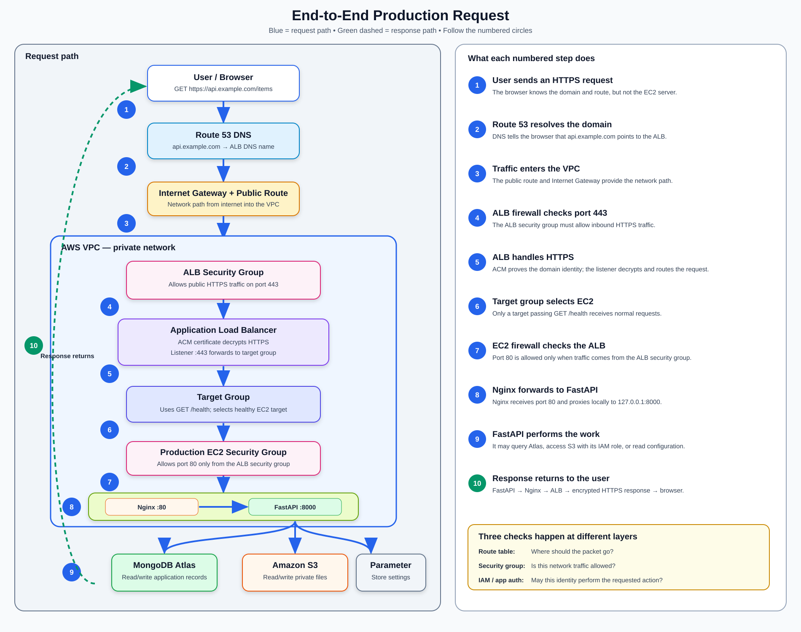

# Lesson 3: VPC networking for a complete beginner
## Visual overview

Use this diagram as a map while reading the lesson. Do not try to memorize it immediately—return to it after each section and identify the component you just learned.



The main request follows the blue arrows:

```text
User -> Internet Gateway -> ALB -> EC2/Nginx -> FastAPI
```

The dashed arrows show FastAPI making outbound calls to MongoDB Atlas and S3.

## 1. Start with a normal web request

When you open a website, your browser sends a request to another computer:

```text
Your computer                         Server
     |                                   |
     |-------- HTTP request ------------>|
     |<------- HTTP response ------------|
```

For this to work, the browser needs to know:

1. which computer should receive the request;
2. which program on that computer should receive it;
3. whether network rules permit the connection.

IP addresses, ports, routes, and firewalls answer these questions.

## 2. IP address: which computer?

An IPv4 address looks like:

```text
203.0.113.10
```

An IP address identifies a network interface. A server can have more than one address.

### Public IP address

A public IP can be reachable over the internet when routes and firewall rules allow it.

Example idea:

```text
Your laptop -> internet -> EC2 public IP
```

### Private IP address

A private IP is used inside a private network and is not directly routed across the public internet.

Common private ranges include addresses beginning with:

```text
10.x.x.x
172.16.x.x through 172.31.x.x
192.168.x.x
```

An EC2 instance inside a VPC always has a private IP. It may also receive a public IP.

Example:

```text
EC2 private IP: 10.0.1.25
EC2 public IP:  203.0.113.10
```

The exact public example addresses in this lesson are illustrative only.

## 3. Port: which program?

One server can run many network programs. Ports identify which program should receive traffic.

Think of the IP as an apartment building address and the port as an apartment number.

```text
203.0.113.10:80
```

- `203.0.113.10` identifies the server.
- `80` identifies the program listening for HTTP.

Common ports:

| Port | Typical service |
|---|---|
| `22` | SSH terminal access |
| `80` | HTTP |
| `443` | HTTPS |
| `8000` | Our FastAPI/Uvicorn process |
| `27017` | MongoDB |

A port being configured does not guarantee that it works. A program must be listening, and the network rules must allow traffic.

## 4. Inbound and outbound traffic

Direction is always described from the resource being discussed.

For an EC2 server:

```text
Browser ------ request ------> EC2
                inbound

EC2 -------- request ------> MongoDB Atlas
               outbound
```

- Inbound traffic enters the EC2 instance.
- Outbound traffic leaves the EC2 instance.

The response to an allowed connection travels in the opposite direction.

## 5. What is a network?

A network is a group of connected devices that can communicate.

Your home Wi-Fi is a network. Devices normally receive private addresses such as:

```text
Laptop: 192.168.1.10
Phone:  192.168.1.11
Router: 192.168.1.1
```

AWS lets you create a private network for cloud resources. That network is a VPC.

## 6. What is a VPC?

VPC means Virtual Private Cloud.

It is an isolated virtual network inside one AWS Region.

```text
AWS Region: ap-south-1
└── Your VPC
    ├── Subnets
    ├── Route tables
    ├── Internet gateway
    ├── Security groups
    ├── Load balancer
    └── EC2 instances
```

The VPC gives you control over:

- private IP ranges;
- subnet placement;
- routes;
- internet connectivity;
- allowed inbound and outbound traffic.

A VPC does not run application code. It provides the network in which resources run.

## 7. CIDR: what addresses belong to the network?

When creating a VPC, you assign an address range using CIDR notation:

```text
10.0.0.0/16
```

For now, read this as:

```text
The VPC owns a large private address range beginning with 10.0.
```

A `/16` range contains 65,536 total IPv4 addresses. You do not need to memorize the calculation yet.

We divide that large range into smaller subnet ranges:

```text
VPC:             10.0.0.0/16
Public subnet A: 10.0.1.0/24
Public subnet B: 10.0.2.0/24
```

A `/24` contains 256 total IPv4 addresses. AWS reserves some addresses in each subnet, so not all are assignable to your resources.

The subnet ranges must be inside the VPC range and must not overlap each other.

## 8. What is a subnet?

A subnet is a smaller network inside a VPC.

Each subnet belongs to exactly one Availability Zone:

```text
VPC: 10.0.0.0/16

├── Subnet A: 10.0.1.0/24
│   └── Availability Zone ap-south-1a
│
└── Subnet B: 10.0.2.0/24
    └── Availability Zone ap-south-1b
```

Resources receive private IPs from their subnet.

Example:

```text
EC2 in subnet A -> private IP 10.0.1.25
```

## 9. Public subnet versus private subnet

The key difference is the subnet's route table.

### Public subnet

A public subnet has a route to an internet gateway:

```text
0.0.0.0/0 -> Internet Gateway
```

An EC2 instance in that subnet can communicate directly with the internet only when it also has an appropriate public IP and security-group rules.

Important:

```text
Being inside a public subnet does not automatically expose an EC2 instance.
```

### Private subnet

A private subnet does not have a direct route to an internet gateway.

An instance in a private subnet normally needs a NAT Gateway or suitable VPC endpoints for outbound access to public services.

### What will we use?

To keep the first deployment understandable:

- the ALB uses two public subnets;
- dev EC2 uses a public subnet;
- prod EC2 initially uses a public subnet but accepts application traffic only from the ALB;
- private subnets and NAT Gateway are deferred because they add cost and complexity.

The production EC2 can be moved to a private subnet later.

## 10. What is a route?

A route tells AWS where to send a packet based on its destination IP.

```text
Destination IP range -> Next target
```

A route table is attached to a subnet. Resources in that subnet use its routes.

```text
Subnet -> uses Route Table -> chooses a Target
```

Example public route table:

| Destination | Target | Meaning |
|---|---|---|
| `10.0.0.0/16` | `local` | Keep VPC traffic inside the VPC |
| `0.0.0.0/0` | Internet Gateway | Send other IPv4 traffic to the internet |

### Does it route to a subnet?

No. The **subnet uses the route table**. A route points to a target such as `local`, an Internet Gateway, or a NAT Gateway.

AWS already knows which private IP belongs to which resource and subnet.

### Example: ALB calls EC2

```text
ALB -> EC2 private IP -> local route -> EC2
```

Both resources are inside the VPC, so traffic uses the `local` route.

### Example: EC2 calls a public website

```text
EC2 -> 0.0.0.0/0 route -> Internet Gateway -> Website
```

`0.0.0.0/0` means any IPv4 destination not matched by a more specific route.

### Does it work in both directions?

Each packet is routed separately using its destination:

```text
Request  -> route toward the server
Response -> route toward the client
```

Routes provide paths, not permissions:

```text
Route table    = Where should traffic go?
Security group = Is the traffic allowed?
```

## 11. What is an internet gateway?

An internet gateway connects a VPC to the internet.

For public connectivity, all relevant pieces must agree:

```text
1. The VPC has an internet gateway.
2. The subnet route table points internet traffic to it.
3. The resource has suitable public addressing.
4. The security group allows the traffic.
5. A program is listening on the requested port.
```

If one piece is missing, the connection fails.

## 12. What is a security group?

A security group is a firewall attached to an AWS resource such as EC2 or an ALB.

It decides which traffic is allowed.

A rule contains information such as:

```text
Protocol: TCP
Port: 443
Source: 0.0.0.0/0
```

Meaning:

```text
Allow inbound TCP connections to port 443 from any IPv4 address.
```

## 13. Security groups contain allow rules

Security groups do not use explicit deny rules.

- If an allow rule matches, traffic is allowed.
- If no allow rule matches, traffic is blocked.

A new security group normally has no inbound rules, so unsolicited inbound traffic is blocked.

## 14. Security groups are stateful

Suppose inbound HTTPS is allowed:

```text
User -------- HTTPS request --------> ALB
User <------- HTTPS response -------- ALB
```

You allow the incoming request. The response is automatically allowed back because the security group remembers the connection.

You do not need a separate inbound rule for response traffic.

## 15. Sources: IP address versus security group

A security-group rule can allow traffic from an IP range:

```text
Port 443 from 0.0.0.0/0
```

Or from another security group:

```text
Port 80 from fastapi-prod-alb-sg
```

The second rule means:

```text
Allow port 80 traffic when it comes from resources using the ALB security group.
```

This is better than allowing every internet address to access production EC2.

## 16. Our production security groups

### ALB security group

Name:

```text
fastapi-prod-alb-sg
```

Inbound:

| Port | Source | Purpose |
|---|---|---|
| `80` | `0.0.0.0/0` | Redirect HTTP to HTTPS |
| `443` | `0.0.0.0/0` | Receive public HTTPS requests |

### EC2 security group

Name:

```text
fastapi-prod-ec2-sg
```

Inbound:

| Port | Source | Purpose |
|---|---|---|
| `80` | `fastapi-prod-alb-sg` | Receive HTTP only from the ALB |

There is no public inbound rule for port `8000`.

```text
Internet
   |
   | HTTPS :443 allowed
   v
ALB [fastapi-prod-alb-sg]
   |
   | HTTP :80 allowed
   v
EC2 [fastapi-prod-ec2-sg]
   |
   | localhost only
   v
FastAPI :8000
```

## 17. Why Nginx port 80 but FastAPI port 8000?

On the EC2 instance:

```text
Nginx listens on EC2 port 80.
FastAPI listens on 127.0.0.1:8000.
```

Nginx forwards the request internally:

```text
ALB -> EC2:80 -> Nginx -> 127.0.0.1:8000 -> FastAPI
```

Because FastAPI binds to the local address and no security-group rule exposes `8000`, clients cannot bypass Nginx and call FastAPI directly.

## 18. Development traffic

Development has no ALB initially:

```text
Your computer
   |
   | HTTP :80
   v
Dev EC2 + Nginx
   |
   v
FastAPI :8000
```

The dev EC2 security group can temporarily allow:

```text
TCP port 80 from your-public-IP/32
```

`/32` means one exact IPv4 address.

If your internet provider changes your public IP, update the rule.

### Detailed development request diagram

Follow steps `1` through `7`. The explanation panel describes what happens at every step.



## 19. Outbound traffic from EC2

FastAPI also initiates connections:

```text
EC2 -> MongoDB Atlas
EC2 -> S3
EC2 -> ECR
EC2 -> Parameter Store
EC2 -> CloudWatch
```

These are outbound connections from EC2.

During the first setup, the EC2 security group will use the normal broad outbound rule. Later, outbound rules can be narrowed if required.

The route table and internet gateway must also provide a valid path.

## 20. MongoDB Atlas network access

Atlas is outside our VPC. It has its own network access list.

To connect successfully, both sides must allow the flow:

```text
AWS side:
EC2 can make outbound connections.

Atlas side:
The connection source is present in the Atlas IP access list.
```

A database username and password are also required. Network permission and database authentication are separate checks.

Avoid leaving this in Atlas:

```text
0.0.0.0/0
```

It permits connection attempts from every IPv4 address. We will choose a restricted production approach during the Atlas deployment module.

## 21. What about S3 networking?

S3 is an AWS service, but a normal public S3 endpoint is still reached through network routing.

Access requires two independent things:

```text
Network path to S3
+
IAM permission to perform the S3 action
```

A valid network path without IAM permission results in access denied. IAM permission without a usable network path results in a connection failure.

Later, a VPC endpoint can provide private S3 connectivity, but it is not necessary for the first deployment.

## 22. Security group versus IAM role

Beginners often confuse them.

| Security group | IAM role |
|---|---|
| Controls network traffic | Controls AWS API permissions |
| Answers “Can traffic reach this port?” | Answers “May this identity perform this AWS action?” |
| Example: ALB can reach EC2 port 80 | Example: EC2 may upload to an S3 bucket |

For an S3 upload to work, the server needs both network connectivity and IAM permission.

## 23. Security group versus Nginx

These also solve different problems:

| Security group | Nginx |
|---|---|
| AWS network firewall | Program running on EC2 |
| Allows or blocks connections | Accepts and processes allowed HTTP connections |
| Does not forward HTTP by itself | Proxies HTTP to FastAPI |

Allowing port `80` in a security group does not start Nginx. Nginx must actually be installed and running.

## 24. What is a network ACL?

A network ACL is another firewall applied at the subnet level.

For this first deployment, we will keep the default network ACL and use security groups. Custom network ACL rules add complexity and are not required for understanding the basic deployment.

Remember only:

```text
Security group -> resource-level, stateful
Network ACL    -> subnet-level, stateless
```

## 25. End-to-end production request

Follow a single request:

```text
1. The user sends HTTPS traffic to the ALB public address on port 443.
2. The public subnet route and internet gateway provide a path to the ALB.
3. The ALB security group allows inbound port 443.
4. The ALB listener accepts the HTTPS request.
5. The listener chooses the target group.
6. The target group sends HTTP to the EC2 private IP on port 80.
7. The EC2 security group allows port 80 from the ALB security group.
8. Nginx receives the request on port 80.
9. Nginx forwards it locally to FastAPI on port 8000.
10. FastAPI processes the request and returns a response.
11. Response traffic follows the established connections back to the user.
```

### Detailed production request diagram

Follow steps `1` through `10`. The explanation panel covers DNS, routing, security, HTTPS, health checks, Nginx, FastAPI, dependencies, and the response.



## 27. What we are intentionally postponing

You do not need these for the first deployment:

- private production subnets;
- NAT Gateway;
- VPC endpoints;
- custom network ACLs;
- VPC peering with Atlas;
- IPv6 design;
- Transit Gateway;
- Direct Connect;
- advanced multi-VPC architecture.

We will introduce a topic only when the application needs it.

## 28. Draw this from memory

```text
AWS Region
└── VPC 10.0.0.0/16
    ├── Public subnet A 10.0.1.0/24
    │   ├── ALB node
    │   └── Production EC2
    │
    ├── Public subnet B 10.0.2.0/24
    │   └── ALB node
    │
    ├── Internet gateway
    ├── Public route table
    │   └── 0.0.0.0/0 -> internet gateway
    │
    ├── ALB security group
    │   └── inbound 80/443 from internet
    │
    └── EC2 security group
        └── inbound 80 from ALB security group
```

The diagram is conceptual. AWS manages the ALB nodes.

## 29. Check your understanding

1. What is the difference between a public and private IP?
2. What is the difference between an IP and a port?
3. What is a VPC?
4. Why divide a VPC into subnets?
5. What makes a subnet public?
6. Does a public subnet automatically expose every EC2 instance?
7. What does `0.0.0.0/0` mean in a route?
8. What does an internet gateway do?
9. What does a security group do?
10. Why can the ALB reach EC2 but the public internet cannot directly reach EC2 port `80`?
11. Why is FastAPI port `8000` not public?
12. What is the difference between a security group and an IAM role?
13. Why can an ALB health check fail even when EC2 is running?
14. Why does Atlas need both network permission and a database user?

## 30. Answers

1. A public IP can be routed over the internet; a private IP is used inside private networks.
2. An IP identifies a network destination; a port identifies a service at that destination.
3. An isolated virtual network for AWS resources in one Region.
4. To divide address space and place resources into controlled network sections and AZs.
5. Its route table has a route to an internet gateway.
6. No. Public addressing, routes, security rules, and a listening program are also required.
7. Every IPv4 destination not matched by a more specific route.
8. It connects a VPC with the internet.
9. It allows selected inbound and outbound network traffic for attached resources.
10. EC2 port `80` allows the ALB security group as its source, not all internet IPs.
11. Nginx accesses it locally, so external clients do not need direct access.
12. A security group controls network traffic; an IAM role controls AWS API actions.
13. Nginx, FastAPI, the port, the health path, or security rules can still be wrong.
14. The network list controls where connections may originate; the database user authenticates and authorizes database operations.


No need for now:
---------------
## 26. Why a connection might fail

Think layer by layer.

### The browser cannot reach the ALB

Check:

- DNS points to the correct ALB;
- ALB is internet-facing;
- ALB uses public subnets;
- subnet route points to the internet gateway;
- ALB security group allows `443`;
- listener exists on `443`.

### ALB reports an unhealthy EC2 target

Check:

- target uses the correct EC2 instance and port `80`;
- EC2 security group permits port `80` from the ALB security group;
- Nginx is running;
- Nginx can reach FastAPI;
- `/health` returns HTTP `200`;
- health-check path and port are correct.

### FastAPI cannot reach MongoDB Atlas

Check:

- connection string and database user;
- Atlas IP access list;
- DNS resolution;
- EC2 outbound rules;
- subnet internet route;
- Atlas cluster status.

### FastAPI receives S3 access denied

Check IAM role and bucket policy first. “Access denied” usually means the network connection succeeded but authorization failed.
