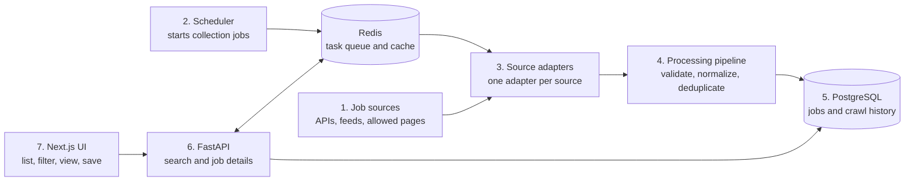

# 1. High-level architecture



## What each number does

1. **Job sources:** Public APIs, RSS feeds, ATS feeds, or permitted career pages.
2. **Scheduler:** Decides when each source should run—for example, every 30 minutes.
3. **Source adapters:** Fetch and parse source-specific data into one common format.
4. **Processing pipeline:** Cleans fields, validates records, and detects duplicate jobs.
5. **PostgreSQL:** Stores jobs, companies, sources, and collection results.
6. **FastAPI:** Provides endpoints used by the web application.
7. **Next.js UI:** Displays job cards, filters, details, and saved jobs.

Redis carries background tasks so scraping does not block a user's API request.

## Important boundary

```text
Collection system writes jobs.
Public API reads jobs.
Frontend never calls job portals directly.
```

This keeps portal logic and credentials away from the browser.
