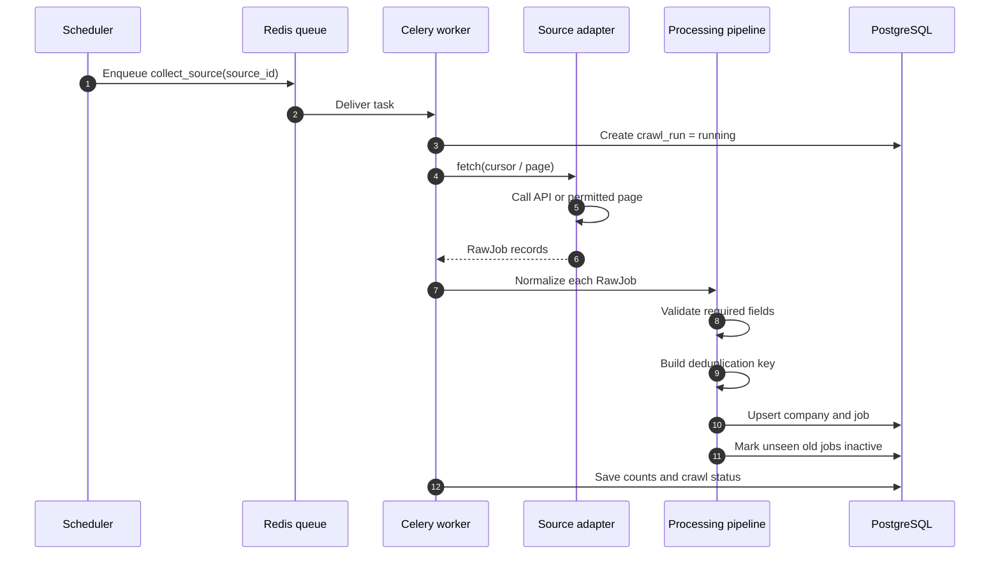
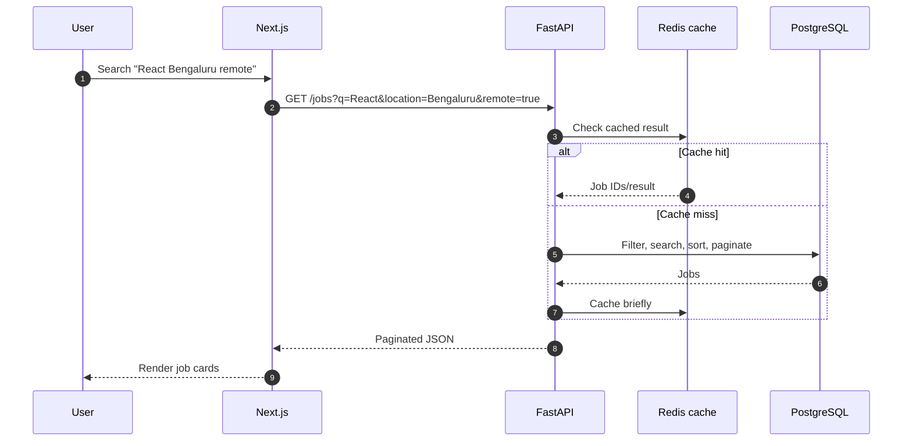

# 2. Low-level architecture

## Complete collection flow



## Adapter contract

Every portal has different field names. Each adapter must return the same `RawJob` shape:

```python
class RawJob:
    source: str
    external_id: str | None
    title: str
    company_name: str
    location_text: str | None
    description_html: str
    apply_url: str
    posted_at: datetime | None
    employment_type: str | None
    remote_type: str | None
```

Example mappings:

```text
Greenhouse departments  -> categories
Lever workplaceType     -> remote_type
Career-page jobLocation -> location_text
```

The rest of the application never needs to understand portal-specific names.

## Search request flow



## Failure handling

```text
Temporary timeout -> retry with delay
Invalid record    -> skip it and log the reason
Parser broken     -> fail only that source
Database error    -> retry task; do not lose crawl status
Repeated failure  -> alert and disable that source temporarily
```

Never let one broken adapter stop the other sources.
