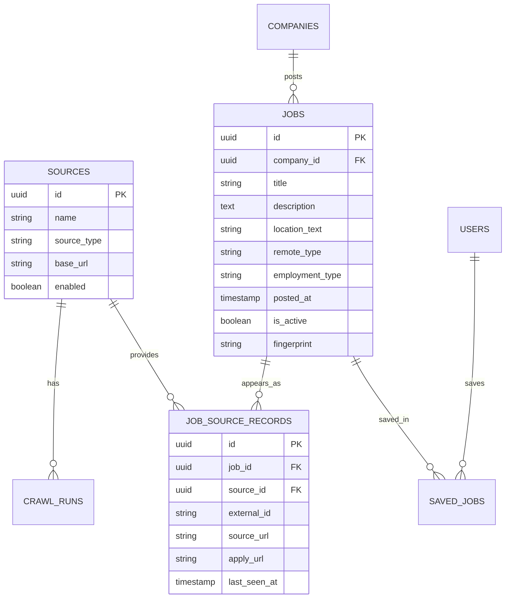

# 4. Database and API design

## Main tables



## Why separate `jobs` and `job_source_records`?

The same job may appear on a company site and another permitted feed.

```text
One real job
  -> Greenhouse source record
  -> Company careers source record
```

The UI shows one job, while retaining every valid source and apply URL.

## Deduplication

Use these checks in order:

1. Same `source_id + external_id` → same source record.
2. Canonical apply URL matches → likely same job.
3. Fingerprint matches → compare normalized company, title, location, and description.

Do not merge automatically when similarity is uncertain. Record a possible duplicate for review.

## First API endpoints

```text
GET  /api/v1/jobs                 list, filter, sort, paginate
GET  /api/v1/jobs/{job_id}        job details
GET  /api/v1/companies            company filter options
GET  /api/v1/sources              enabled sources
POST /api/v1/jobs/{job_id}/save   save a job
DELETE /api/v1/jobs/{job_id}/save remove saved job
```

Example query:

```text
GET /api/v1/jobs?q=react&location=hyderabad&remote_type=remote&page=1
```

Use cursor pagination later if the table becomes very large. Page/limit pagination is fine for the MVP.
