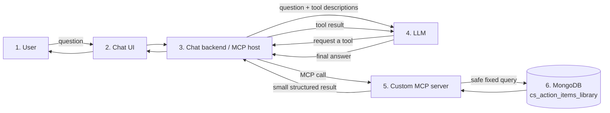

# 2. Architecture

## High-level architecture



## What each part does

1. **User:** Asks a normal-language question.
2. **Chat UI:** Displays messages. It never connects to MongoDB.
3. **Chat backend/MCP host:** Calls the LLM and manages MCP connections.
4. **LLM:** Understands the question and selects an appropriate tool.
5. **Custom MCP server:** Validates tool inputs and runs predefined queries.
6. **MongoDB:** Stores `cs_action_items_library` documents.

## Why not let the LLM query MongoDB directly?

The LLM could generate a dangerous or incorrect query. The custom server exposes only controlled operations:

```text
Allowed: search_action_items(search="kickoff", priority="HIGH")
Blocked: run_any_mongodb_query({"$where": "..."})
```

## Relationship to the existing customer-success code

```text
Existing FastAPI routes ─┐
                         ├──> tenant MongoDB ──> cs_action_items_library
New custom MCP server ───┘
```

The existing REST API remains useful for the normal product UI. MCP is an additional interface designed for an LLM chatbot.

For the local learning version, one configured `MONGO_DATABASE` represents one tenant. In production, the authenticated user's tenant must be resolved by trusted backend code—never accepted blindly from the LLM.

## Processes in version 1

```text
Process A: chatbot backend + LLM client
Process B: action-items-library MCP server
External dependency: MongoDB
```

The local host starts Process B and communicates through `stdio`. No separate MCP HTTP deployment is required while learning.
