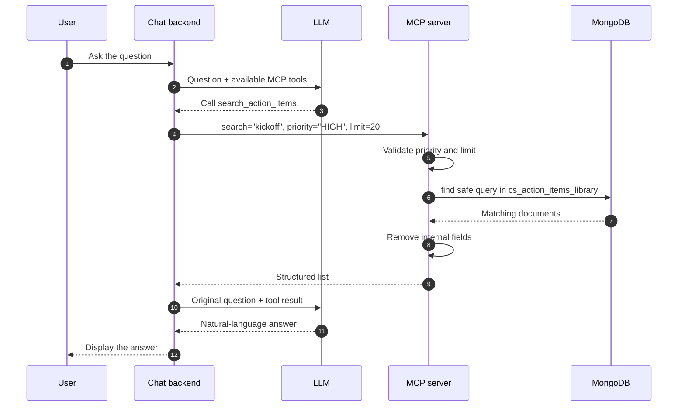

# 4. One complete question flow

Question:

```text
Show me HIGH-priority action-item templates related to kickoff.
```



## What the LLM does

- understands that “related to kickoff” means a search;
- chooses `search_action_items`;
- passes typed arguments;
- explains the returned records.

## What the MCP server does

- validates inputs;
- escapes search text;
- selects the fixed collection;
- limits the number of results;
- returns only allowed fields.

## What MongoDB does

MongoDB only executes the query and returns documents. It does not understand the user's full sentence and does not generate the final answer.

## When no tool is needed

If the user asks:

```text
"What does HIGH priority mean in the result you just showed?"
```

the LLM may answer from the existing conversation. It should not call MongoDB again unless fresh data is required.
