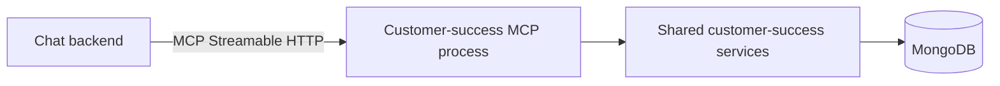

# 8. Production code arrangement

## Short answer

You do **not** need to rewrite the customer-success application.

Keep one common MCP implementation in the **customer-success repository** and make it a thin layer over the services you already have.

```text
REST routes ─┐
             ├──> existing business/service code ──> MongoDB
MCP tools ───┘
```

The MCP layer should translate a tool call into an existing service-function call. It should not contain another copy of the MongoDB query.

## Recommended repository structure

```text
customer-success/
├── app/
│   ├── action_items_library/
│   │   ├── api/                 # Existing REST routes
│   │   ├── models/              # Existing Pydantic models
│   │   └── services/            # Existing business and MongoDB logic
│   ├── objectives_library/
│   ├── guided_workflows/
│   ├── success_path/
│   └── mcp/
│       ├── server.py            # One customer-success MCP server
│       ├── context.py           # Authenticated user and tenant
│       └── tools/
│           ├── action_items_library.py
│           ├── objectives_library.py
│           └── guided_workflows.py
└── tests/
    └── mcp/
```

Use one file per business area, but register every approved tool on one MCP server.

```python
# app/mcp/server.py
from mcp.server import MCPServer

mcp = MCPServer("Customer Success")

# Importing these modules registers their tools.
from app.mcp.tools import action_items_library  # noqa: E402, F401
```

## A tool should be only a wrapper

Conceptually, the Action Items Library tool should look like this:

```python
@mcp.tool()
async def search_action_item_templates(
    search: str | None = None,
    priority: str | None = None,
    limit: int = 20,
    ctx: Context = ...,          # trusted request context
) -> dict:
    tenant = get_authorized_tenant(ctx)

    result = await list_action_items_library(
        tenant=tenant,
        search=search,
        skip=0,
        limit=min(limit, 50),
    )
    return result.model_dump(mode="json")
```

It reuses the existing `list_action_items_library()` service. It does not call MongoDB itself.

## What gets reused?

| Existing code | Reuse from MCP? |
|---|---|
| MongoDB connection and tenant resolution | Yes |
| Service functions | Yes |
| Pydantic models and validation | Yes |
| Logging | Yes |
| Business rules such as unique action names | Yes |
| FastAPI route functions | No |
| HTTP request/response objects | No |

Call the service layer—not the REST endpoint. Calling your own HTTP endpoint adds another network call and duplicates authentication work.

## Do we need many changes?

### First version: small changes

For every chatbot capability:

1. Add one small MCP tool wrapper.
2. Call the existing service.
3. Convert its Pydantic response to a dictionary.
4. Add tests that mock the service.

You do not need to MCP-enable every function. Expose only the operations useful to the chatbot.

### Gradual cleanup when needed

Some current services raise FastAPI `HTTPException`. That works, but it couples business code to HTTP.

The cleaner long-term structure is:

```text
Service raises NotFoundError
    ├── REST adapter converts it to HTTP 404
    └── MCP adapter converts it to a useful tool error
```

Do this gradually when touching a service. Do not rewrite the entire repository before starting MCP.

## Same repository does not mean same process

Code location and deployment are separate decisions.

### Recommended starting production setup



Keep the code in the same repository, but run the MCP entry point as its own process/container when you need independent scaling or access control.

```text
Same Docker image, different commands:

API container -> starts FastAPI REST application
MCP container -> starts the customer-success MCP server
```

Both containers import the same Python service code. No duplication is required.

### Even simpler internal setup

If only the customer-success FastAPI deployment will expose MCP, the Python SDK can mount a Streamable HTTP MCP application inside the existing FastAPI/ASGI app.

This gives one deployment, but REST and MCP then scale and fail together. The parent FastAPI lifespan must also start the MCP session manager.

## When should MCP be a separate repository?

Use a separate repository only if:

- a different team owns the MCP product;
- it integrates many independent systems;
- it cannot import customer-success code;
- it has a completely separate release lifecycle.

If you separate it now, it must either duplicate business logic or call customer-success through REST. Neither is useful for the current requirement.

## One common MCP server, not one per feature

Use names that make the business area clear:

```text
search_action_item_templates
get_action_item_template
search_objective_templates
get_guided_workflow
```

Do not expose every service function automatically. A smaller tool list makes tool selection more accurate and reduces security risk.

## Migration path

```text
Step 1: Move the learning MCP tools into customer-success/app/mcp.
Step 2: Replace direct MongoDB calls with existing service calls.
Step 3: Add authenticated tenant context.
Step 4: Add read-only tools for one module at a time.
Step 5: Test with the chatbot.
Step 6: Add write tools only when required and confirmed by the user.
Step 7: Deploy as a separate process from the same codebase if needed.
```

## Final recommendation

```text
Repository: one customer-success repository
MCP servers: one common Customer Success MCP server
Tool organization: one tool module per feature area
Business logic: reuse existing services
MongoDB access: only through existing database/service layer
Initial tools: read-only
Deployment: separate process later, not a separate codebase
```

This arrangement adds an MCP interface to your existing application; it does not rebuild the application around MCP.

Reference: [Official Python SDK guide for adding MCP to an existing FastAPI/ASGI application](https://github.com/modelcontextprotocol/python-sdk/blob/main/docs/run/asgi.md)
