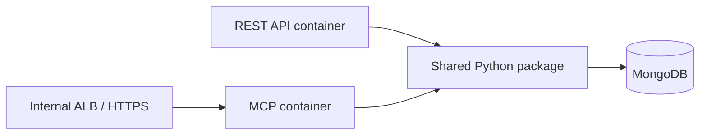

# 9. MCP internals and deployment

You do not need to memorize the entire MCP specification. Learn the following concepts well enough to explain the Action Items Library chatbot.

## Part 1 — Internals useful for interviews

### 1. What MCP solves

MCP is a standard way for an AI application to discover and call external capabilities.

Without MCP, every LLM integration uses custom function definitions and connection code. With MCP, the chatbot can connect to any compatible server through the same protocol.

### 2. Host, client, and server

```text
Chat application = MCP host
Connection managed by the host = MCP client
Customer-success integration = MCP server
```

The LLM does not directly connect to MongoDB or open the network connection. The host controls tool execution.

### 3. MCP messages use JSON-RPC

MCP requests and responses are structured JSON-RPC messages.

Conceptually:

```json
{
  "method": "tools/call",
  "params": {
    "name": "search_action_item_templates",
    "arguments": {"search": "kickoff", "priority": "HIGH"}
  }
}
```

The SDK creates and parses these messages. You normally write only Python functions and type hints.

### 4. Discovery happens before tool usage

The client discovers what the server supports and obtains its tool definitions.

```text
Server exposes:
  tool name
  description
  input schema
  output information
```

The LLM sees these definitions and decides whether a tool can help answer the question.

Modern MCP uses `server/discover`. Older MCP versions use an `initialize` handshake followed by operations such as `tools/list`. Current SDKs handle compatibility, so application code normally does not implement version negotiation.

### 5. Tool call lifecycle

```text
1. User asks a question.
2. Host sends the question and tool definitions to the LLM.
3. LLM requests a tool with arguments.
4. Host validates/approves and sends the MCP call.
5. MCP server validates arguments and calls the existing service.
6. Tool returns structured data.
7. LLM uses that data to write the final answer.
```

The tool result and final chatbot answer are different things.

### 6. MCP primitives

MCP can expose:

| Primitive | Meaning | Our use |
|---|---|---|
| Tool | Perform a controlled operation | Search MongoDB through existing services |
| Resource | Read addressable context | Not required initially |
| Prompt | Reusable instruction template | Not required initially |

For this chatbot, tools are enough. Do not add resources and prompts only to demonstrate terminology.

### 7. Transports

A transport carries MCP messages.

```text
stdio           -> local child process; no URL or port
Streamable HTTP -> deployed server with an /mcp endpoint
SSE             -> older transport; avoid for a new project
```

Transport changes how messages travel, not the tool's business logic.

### 8. MCP versus REST

| REST API | MCP server |
|---|---|
| Designed mainly for applications | Designed for AI hosts and tool discovery |
| Many URLs and HTTP methods | Protocol methods such as tool discovery and tool calls |
| Frontend knows which endpoint to call | LLM selects from described tools |
| Usually JSON over HTTP | JSON-RPC over stdio or Streamable HTTP |

MCP does not replace your existing REST APIs. Both can call the same service layer.

## Interview questions you should answer

### Why MCP instead of giving MongoDB access to the LLM?

It exposes a small, validated set of business operations. The model cannot choose collections or submit arbitrary MongoDB queries.

### Why one common customer-success MCP server?

The features share authentication, tenant resolution, MongoDB access, models, and services. Tool modules can remain separated by business area inside one server.

### How do you prevent cross-tenant access?

Derive the tenant from the authenticated request context. Never trust a tenant or database name generated by the LLM.

### How do you prevent hallucination?

Require tools for current data, return structured results, use clear tool descriptions, and instruct the LLM not to invent missing records. MCP reduces uncontrolled access; it does not eliminate all LLM mistakes.

### How do you handle errors?

The service raises a business error, the MCP adapter returns a safe tool error, and the LLM explains it. Internal stack traces and credentials are logged securely but are not returned to the model.

## Part 2 — Local testing

There are three useful test levels.

### Level 1: in-process unit tests

```text
Test client -> MCP server object -> mocked customer-success service
```

Use this for fast tests of tool names, validation, arguments, and results. No port, subprocess, LLM, or MongoDB is required.

### Level 2: MCP Inspector with `stdio`

```text
Inspector -> starts MCP Python process -> development MongoDB
```

Example:

```bash
uv run mcp dev app/mcp/server.py
```

Inspector starts the server as a child process and communicates through standard input/output. There is no MCP port.

Use Inspector to verify:

- tool discovery;
- generated input schemas;
- valid and invalid arguments;
- returned data and errors.

### Level 3: chatbot integration test

```text
Local chat UI -> chat backend -> LLM -> local MCP server -> development MongoDB
```

This verifies that the LLM selects the correct tool and turns its output into a correct answer.

Never use production MongoDB credentials for local testing.

## Part 3 — Production deployment

### Is it deployed like FastAPI?

Mostly yes when using Streamable HTTP.

An MCP HTTP application is an ASGI application. It can use the same production building blocks as FastAPI:

- Docker image;
- Uvicorn/process manager;
- EC2, ECS, or another container platform;
- Application Load Balancer;
- HTTPS;
- environment variables or a secret manager;
- logs, health checks, timeouts, and monitoring.

The important difference is the endpoint protocol:

```text
FastAPI REST: /api/v1/... endpoints
MCP:          /mcp endpoint using Streamable HTTP and MCP messages
```

### Option A: mount MCP inside existing FastAPI

```mermaid
flowchart LR
    ALB[ALB / HTTPS] --> APP[Customer-success FastAPI process]
    APP --> REST[/api/v1 routes]
    APP --> MCP[/mcp endpoint]
    REST --> S[Shared services]
    MCP --> S
    S --> DB[(MongoDB)]
```

Advantages:

- one image and deployment;
- direct reuse of services and connection pools;
- simplest infrastructure.

Trade-off:

- REST and MCP scale, deploy, and fail together.

The MCP SDK's session manager must be started from the parent FastAPI lifespan when the MCP ASGI app is mounted.

### Option B: separate MCP process from the same repository



Advantages:

- independent scaling and deployment;
- stronger network and permission isolation;
- an MCP failure does not stop normal REST traffic.

Trade-off:

- one additional process/service to deploy and monitor.

The containers can use the same Docker image with different startup commands. They still use one repository and one copy of the business code.

## Recommendation for customer-success

```text
Local development:
  stdio + MCP Inspector

First internal production version:
  same customer-success repository
  one common MCP server
  Streamable HTTP
  mount in FastAPI if traffic is small and deployment simplicity matters

Later, if usage or isolation requires it:
  run MCP as a separate container from the same image/codebase
```

## Production requirements beyond local testing

- HTTPS for remote MCP.
- Authentication at the HTTP boundary.
- Tenant authorization derived from the authenticated user.
- Host/origin allowlists required by the SDK for a real hostname.
- Read-only MongoDB permissions for read tools.
- Request limits, timeouts, rate limiting, and audit logs.
- Health checks for the process and MongoDB readiness.
- No secrets or internal exceptions in tool results.

## Five-line interview summary

```text
MCP is a standard client-server protocol for connecting AI applications to tools and data.
It uses structured JSON-RPC messages and supports tool discovery and invocation.
I use stdio with Inspector for local development and Streamable HTTP in production.
The MCP tools are thin adapters over existing customer-success services, not duplicated MongoDB logic.
It deploys like an ASGI/FastAPI service, with additional MCP transport, authorization, and tenant-safety concerns.
```

References: [Official Python SDK transport guide](https://github.com/modelcontextprotocol/python-sdk/blob/main/docs/run/index.md), [deployment guide](https://github.com/modelcontextprotocol/python-sdk/blob/main/docs/run/deploy.md), and [mounting inside an ASGI/FastAPI application](https://github.com/modelcontextprotocol/python-sdk/blob/main/docs/run/asgi.md).
